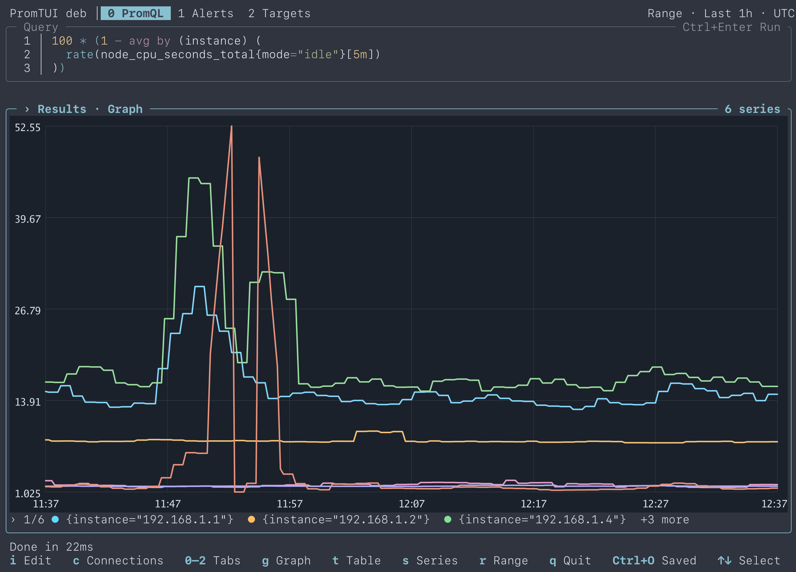

# PromTUI

A keyboard-driven terminal UI for **Prometheus** and **VictoriaMetrics**. Run PromQL queries, visualize time series, inspect Alertmanager alerts, and browse scrape targets without leaving your terminal.



## Features

- Multiline PromQL editor with syntax highlighting, completion, history, and saved queries
- Instant-query tables and range-query graphs with series filtering
- Alertmanager alert browser with filtering and sorting
- Prometheus and vmagent scrape-target inspection
- Multiple backend connections with fast switching

## Quick start

Requires Go 1.25 or newer.

```sh
make build
cp config.example.yaml config.yaml
./bin/promtui -config config.yaml
```

Press **i** to edit a query and **Ctrl+Enter** to run it. Use **g** for Graph, **t** for Table, **0–2** to switch tabs, **c** to change connections, and **?** for help. Graphs require a terminal with Kitty graphics support, such as Kitty or Rex.

## Example configuration

```yaml
general:
  default_connection: local

query:
  default_range: 1h

connections:
  local:
    url: http://localhost:9090
    alertmanager_url: http://localhost:9093 # optional
```

Default paths on macOS and Linux:

- **Config:** `~/.config/promtui/config.yaml`, then `config.yml`, then `config.toml`
- **Saved queries:** `~/.local/share/promtui/queries.yaml`
- **History:** `~/.local/share/promtui/history.jsonl`

Start with the full [`config.example.yaml`](config.example.yaml), or pass any YAML or TOML config with `-config PATH`. See the [configuration reference](docs/configuration.md) for all settings, TLS options, and target sources.

## License

PromTUI is licensed under the [MIT License](LICENSE.txt).
